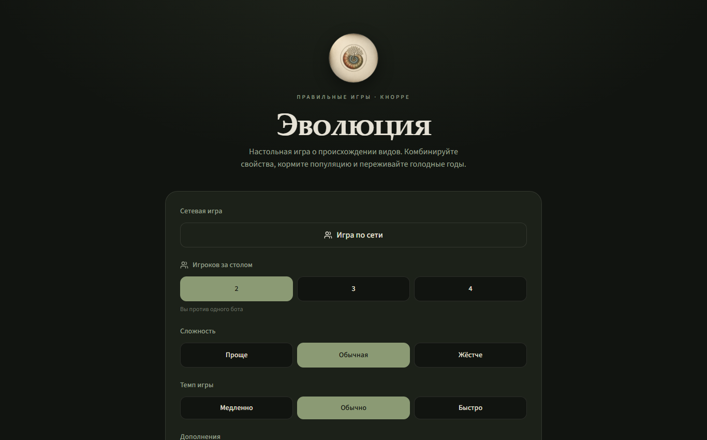
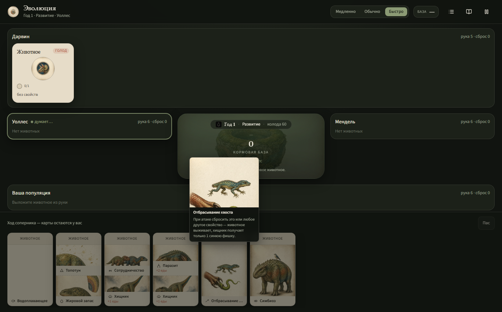

# Evolution Online

[](https://github.com/jegorRegularUser/evolution-online/actions/workflows/ci.yml)

An online, browser-based adaptation of *Evolution*, the board game by Dmitry Knorre (Right Games). Create animals, attach traits, hunt, survive hungry years, and outscore your opponents. Playable in Russian and English, against people or bots, at one shared table.

*[Русская версия](README.ru.md)*

| Main menu | Game table |
| --- | --- |
|  |  |

## Game content

- The base game: 45 traits, 2 to 4 players, development and feeding phases, hungry years, extinction and scoring.
- Four modules that can be mixed per table: **Continents**, **Plants**, **Grass and Mushrooms** (flora cards, 10 plant species), and **Random Mutations**.
- Module compatibility follows the publisher FAQ: Grass and Mushrooms cannot be combined with Plants or Random Mutations. The UI explains the restriction and the server enforces it on table creation and settings changes.
- Bots with three difficulty levels and three game tempos.
- A built-in rules reference covering the base game and every module.

## What the implementation includes

- Online multiplayer: shared tables, real-time state over server functions, spectators, and an in-game chat.
- Tables and games persist in PostgreSQL, or in an embedded PGlite database when no external database is configured.
- Accounts via better-auth, with the auth schema applied only when auth is enabled.
- A 3D dice roll for the food bank, rendered with three.js and cannon-es.
- Session statistics and end-of-game charts (recharts).
- An installable PWA: web manifest, icons, and an install page.
- Full Russian and English localization, including game terms, engine journal messages, and server error messages.

## Quick start

You need Node.js 22.

```bash
npm ci
npm run dev
```

The dev server listens on `http://localhost:8099`. No database setup is needed for local play: without `DATABASE_URL` the app uses an embedded PGlite database and applies migrations itself at startup.

## Scripts

| Command | What it does |
| --- | --- |
| `npm run dev` | Dev server on port 8099 |
| `npm run build` | Production build, then apply migrations (no-op without `DATABASE_URL`) |
| `npm run preview` | Preview the built output |
| `npm test` | Run the test suite via the bundled runner |
| `npm run typecheck` | `tsc --noEmit` |
| `npm run lint` | ESLint |
| `npm run format` | Prettier |
| `npm run qa` | Playwright QA suites (screenshots land in `screenshots/`) |
| `npm run db:migrate` | Apply pending files from `migrations/` to `DATABASE_URL` |

## Testing and QA

`npm test` runs a self-contained runner (`scripts/test-runner.mjs`) that discovers test files and executes them with Node; it covers the game engine, the netcode, and infrastructure contracts. CI (GitHub Actions and Gitea) runs typecheck, tests, and a build on every push to `main`. The build in CI uses an empty `DATABASE_URL`, so it exercises the embedded-database path.

The Playwright suites under `scripts/qa-*.mjs` walk the real UI: menu flows, module matrices, spectating, rate limits, and both languages at desktop and mobile widths.

## Localization

The UI ships in Russian and English. There is no third-party i18n library; `src/lib/i18n/` holds a typed custom layer:

- `ru.ts` is the canonical dictionary; `en.ts` is type-checked against it, so a missing key fails the build.
- `terms.ts` carries English names and descriptions for every game term: traits, flora, plants, marks, territories, achievements.
- The engine journal stores a translation key alongside each message, so old saves in Russian still render correctly in English.
- Server errors carry machine codes; the client maps codes to localized text and never shows the raw server message.
- Language is detected from the browser, persisted in `localStorage`, and switched from the top bar.

## Tech stack

React 19, TanStack Start (streaming SSR on Nitro, Vercel preset), Vite 8, Tailwind CSS 4, zustand, TanStack Query, TanStack Router, better-auth, Kysely, zod, three.js with cannon-es, dnd-kit, recharts, Playwright.

## Project layout

```
src/
  game/       Engine: traits, flora, plants, bots, journal (framework-agnostic)
  components/ Game table, screens, top bar, dice, event feed
  lib/        i18n, netcode, auth, db, stats, OG meta
  routes/     Single-route app shell (TanStack Start)
  store/      Client state (zustand)
server/       Nitro middleware
migrations/   SQL migrations, applied at build time or on PGlite startup
scripts/      Test runner, Playwright QA suites, deployment helpers
```

## Deployment

The Nitro preset targets Vercel. `npm run build` produces the bundle and then applies pending migrations to `DATABASE_URL` in one transaction per file; each migration runs once and is safe to re-run. Deployed builds run with auth enabled through the platform environment.
