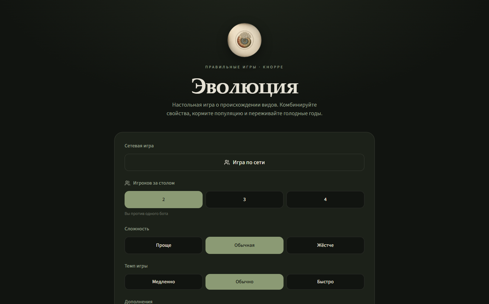
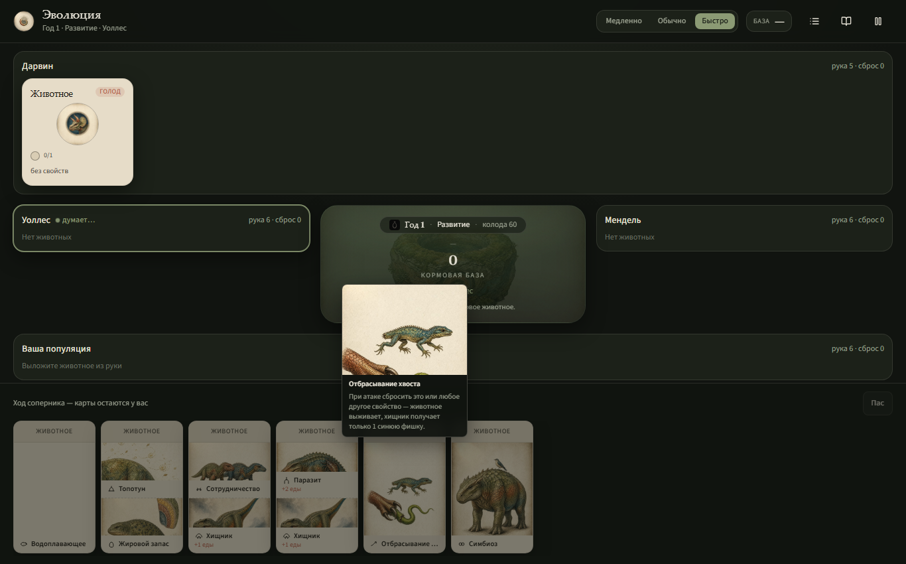

# Эволюция Онлайн

[](https://github.com/jegorRegularUser/evolution-online/actions/workflows/ci.yml)

Онлайн-адаптация настольной игры «Эволюция» Дмитрия Кнорре (Right Games) в браузере. Создавайте животных, прикрепляйте свойства, охотьтесь, переживайте голодные годы и набирайте очки видами. Игра доступна на русском и английском, с людьми или с ботами, за одним общим столом.

*[English version](README.md)*

**Играть онлайн:** <https://evolution-online.vercel.app/>

| Главное меню | Игровой стол |
| --- | --- |
|  |  |

## Игровой контент

- Базовая игра: 45 свойств, от 2 до 4 игроков, фазы развития и кормления, голодные годы, вымирание и подсчёт очков.
- Четыре модуля на выбор для каждого стола: **Континенты**, **Растения**, **Трава и грибы** (карты флоры, 10 видов растений) и **Случайные мутации**.
- Совместимость модулей следует FAQ издателя: «Трава и грибы» не сочетается с «Растениями» и «Случайными мутациями». Интерфейс объясняет запрет, сервер проверяет его при создании стола и смене настроек.
- Боты трёх уровней сложности и три темпа игры.
- Встроенная справка по правилам базовой игры и каждого модуля.

## Что включает реализация

- Сетевая игра: общие столы, состояние в реальном времени через server functions, наблюдатели и чат за столом.
- Хранение столов и партий в PostgreSQL либо во встроенной базе PGlite, если внешняя база не настроена.
- Аккаунты через better-auth, схема авторизации применяется только при включённой авторизации.
- Бросок 3D-кубика кормовой базы на three.js и cannon-es.
- Статистика партии и графики по итогам (recharts).
- Устанавливаемое PWA: веб-манифест, иконки и страница установки.
- Полная локализация на русский и английский: игровые термины, журнал движка, сообщения об ошибках сервера.

## Быстрый старт

Нужен Node.js 22.

```bash
npm ci
npm run dev
```

Dev-сервер слушает `http://localhost:8099`. База данных для локальной игры не нужна: без `DATABASE_URL` приложение использует встроенную PGlite и само применяет миграции при старте.

## Скрипты

| Команда | Что делает |
| --- | --- |
| `npm run dev` | Dev-сервер на порту 8099 |
| `npm run build` | Продакшен-сборка, затем применение миграций (без `DATABASE_URL` — пропуск) |
| `npm run preview` | Предпросмотр собранной версии |
| `npm test` | Тесты через встроенный runner |
| `npm run typecheck` | `tsc --noEmit` |
| `npm run lint` | ESLint |
| `npm run format` | Prettier |
| `npm run qa` | Playwright QA-наборы (скриншоты пишутся в `screenshots/`) |
| `npm run db:migrate` | Применение новых файлов из `migrations/` к `DATABASE_URL` |

## Тесты и QA

`npm test` запускает автономный runner (`scripts/test-runner.mjs`), который находит тестовые файлы и выполняет их через Node; покрытие охватывает движок игры, сетевой слой и инфраструктурные контракты. CI (GitHub Actions и Gitea) на каждый пуш в `main` гоняет typecheck, тесты и сборку. Сборка в CI идёт с пустым `DATABASE_URL`, то есть по пути встроенной базы.

Playwright-наборы в `scripts/qa-*.mjs` проходят реальный интерфейс: меню, матрицы модулей, наблюдение за столом, лимиты запросов, оба языка на десктопе и в мобильной ширине.

## Локализация

Интерфейс поставляется на русском и английском. Сторонней библиотеки i18n нет; `src/lib/i18n/` содержит типизированный собственный слой:

- `ru.ts` — канонический словарь; `en.ts` типобезопасно сверяется с ним, пропущенный ключ роняет сборку.
- `terms.ts` хранит английские названия и описания всех игровых терминов: свойства, флора, растения, метки, территории, достижения.
- Журнал движка хранит вместе с сообщением ключ перевода, поэтому старые сохранения на русском корректно отображаются на английском.
- Ошибки сервера несут машинные коды; клиент переводит коды в локализованный текст и не показывает «сырое» сообщение сервера.
- Язык определяется из браузера, хранится в `localStorage` и переключается в верхней панели.

## Технологии

React 19, TanStack Start (streaming SSR на Nitro, пресет Vercel), Vite 8, Tailwind CSS 4, zustand, TanStack Query, TanStack Router, better-auth, Kysely, zod, three.js с cannon-es, dnd-kit, recharts, Playwright.

## Структура проекта

```
src/
  game/       Движок: свойства, флора, растения, боты, журнал (без привязки к фреймворку)
  components/ Игровой стол, экраны, верхняя панель, кубик, лента событий
  lib/        i18n, сетевой слой, авторизация, база, статистика, OG-мета
  routes/     Одностраничная оболочка приложения (TanStack Start)
  store/      Клиентское состояние (zustand)
server/       Middleware Nitro
migrations/   SQL-миграции, применяются при сборке или на старте PGlite
scripts/      Test runner, Playwright QA-наборы, помощники деплоя
```

## Деплой

Пресет Nitro ориентирован на Vercel. `npm run build` собирает бандл и применяет новые миграции к `DATABASE_URL`: по одной транзакции на файл, каждая миграция выполняется один раз и безопасна при повторном запуске. Деплой-сборки работают с включённой авторизацией через окружение платформы.

## Права

Это неофициальная фан-адаптация настольной игры **«Эволюция»** — автор правил Дмитрий Кнорре, издатель Right Games ([rightgames.ru](https://rightgames.ru)).

- Проект не аффилирован с автором и издателем и не одобрен ими; существует в некоммерческих целях — без рекламы, платных функций и сбора платежей.
- Все права на настольную игру «Эволюция», её название, правила и официальные материалы принадлежат Дмитрию Кнорре и Right Games.
- Иллюстрации и иконки проекта сгенерированы нейросетями специально для этой адаптации и не воспроизводят материалы издателя.
- Страница атрибуции в приложении: `/about`.
- По первому требованию правообладателя проект будет снят с публикации.
